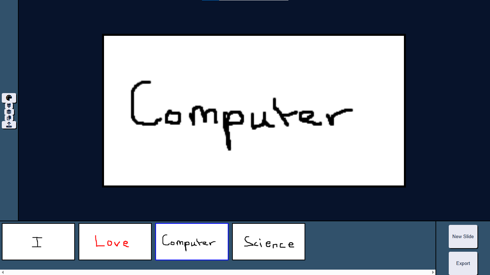
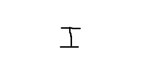

# GIF Maker

### Description
A personal project where I wanted to make my own small gifs to then sent around. Using a HTML canvas, it allows the user to draw anything they want.

The drawing canvas can be moved using right-click. The frame can also be zoomed into using a mouse with a scrollwheel. 

Multiple frames are able to be added to allow or removed for more longer and in-depth GIFs. Each frame is shown at the bottom and allows the user to switch between them.

Drawing features include a colour palette to change the colours, Size slider to increase the thickness of the brush.
There is a toggle transparency layer button which takes the thumbnail of the previous frame and lays it on top. This is to help with animations to ensure correct movements. A copy button which duplicates the frame is also helpful for animations

An upload button is present for the user to place an image of their choice over the frame to allow tracing of objects for something more realistic. (Especially if they struggle in art)

Using a stack data structure I was able to make a CTRL + Z feature to undo any mistakes as well as a CTRL + Y redo function.

You can download your project as a JSON meaning you can come back at any time to complete it. 

Once the user is ready then they can export their image. Using a Library to help with exporting, the GIF can be downloaded to then be shared.

 

### Usage 
Visit the website https://jan-spalding.github.io/GIF-Maker/ to start using.
